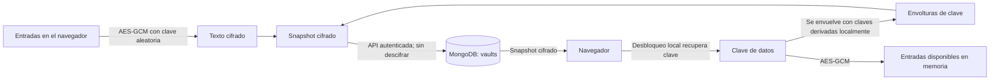
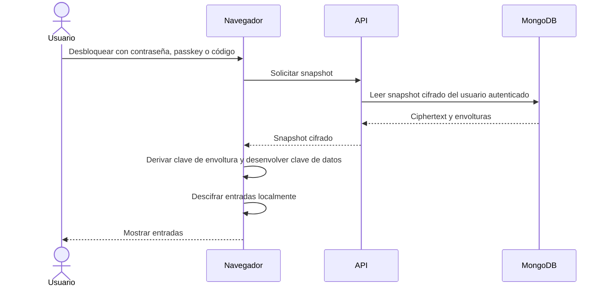

# Damaca Secrets

Aplicación privada para gestionar credenciales personales. Usa Google mediante Better Auth, MongoDB y el panel de aprobación del monorepo. Consulta el [plan de producto](plan/master.md), las [iteraciones](plan/iterations.md) y el [registro de validación](plan/iteration-log.md).

## Seguridad y cifrado del vault

Las entradas del vault (títulos, nombres de usuario, contraseñas, URL y notas) se cifran y descifran en el navegador. MongoDB almacena un snapshot cifrado por usuario en `vaults`; la API valida y persiste ese snapshot sin descifrarlo. El inicio de sesión de Google y la autorización para usar la app son controles de acceso separados del cifrado del vault.



La clave de datos aleatoria cifra las entradas con **AES-GCM de 256 bits**, un nonce aleatorio y datos autenticados que vinculan el cifrado a la versión, al propietario y al propósito. En Mongo se guardan el ciphertext, los nonces y envolturas cifradas de esa clave, no la contraseña maestra ni la clave de datos en claro. La escritura usa una revisión para evitar sobrescribir cambios concurrentes.

La clave de datos se puede desenvolver en el navegador mediante uno de estos métodos:

- **Contraseña maestra:** Argon2id deriva localmente una clave de envoltura usando una sal aleatoria; Mongo guarda la sal y la clave de datos envuelta. El código configura Argon2id con memoria `65536`, iteraciones `3` y paralelismo `4`.
- **Passkey compatible:** el resultado PRF de WebAuthn se usa con HKDF para derivar una clave de envoltura. Mongo guarda el identificador, la sal de PRF y la clave de datos envuelta; el resultado PRF no se envía ni persiste.
- **Código de recuperación:** se genera localmente una clave aleatoria de 32 bytes. Mongo guarda la clave de datos envuelta por ella; la persona conserva el código.

Las claves en claro y las entradas solo están disponibles en el cliente mientras se desbloquea y usa el vault. La app opcionalmente mantiene una copia cifrada en IndexedDB para consulta sin conexión; véase [Consulta sin conexión](#consulta-sin-conexión).

### Flujo de desbloqueo



### Qué protege y qué no

Este diseño da una protección importante ante una **filtración aislada de la base de datos**: obtener Mongo no entrega directamente las credenciales en claro, y los roles de administración de la app no incluyen una clave central para descifrar el vault. La autenticación y autorización de la app también restringen el acceso normal a los snapshots.

El cifrado no cubre todos los escenarios:

- Una contraseña maestra débil facilita ataques de diccionario si alguien obtiene el ciphertext. Argon2id encarece los intentos, pero no sustituye una contraseña única y robusta.
- Un dispositivo comprometido, una extensión maliciosa o el navegador mientras el vault está abierto pueden acceder a entradas y claves disponibles en memoria.
- El navegador ejecuta código servido por el despliegue. Si la aplicación o su cadena de publicación se compromete, ese código podría capturar datos cuando se desbloquea el vault.
- El cifrado del vault no significa que toda la base esté cifrada de extremo a extremo: los datos de autenticación, permisos y metadatos siguen sus propios controles y almacenamiento.

Esta descripción documenta el diseño de la aplicación; no es una auditoría de seguridad ni verifica por sí misma la configuración de producción. Implementación: [cifrado del cliente](src/features/vault/crypto.ts), [flujo de vault](src/features/vault/use-vault.ts), [endpoint](src/app/api/vault/route.ts) y [repositorio MongoDB](src/lib/db/vault.ts).

## Desarrollo

Desde la raíz, instala dependencias con `bun install --frozen-lockfile`. Copia [el ejemplo de entorno](.env.example) a un archivo `.env.local` dentro de la app y configura las credenciales localmente.
- **Google**. Configura un cliente OAuth web con origen `http://localhost:3007` y retorno `http://localhost:3007/api/auth/callback/google`.
- **Better Auth**. Usa un secreto exclusivo de la app y establece `BETTER_AUTH_URL` en el origen usado por el navegador.
- **MongoDB**. Configura `MONGODB_URI` y una base `MONGODB_DB` exclusiva del entorno. Better Auth guarda identidades, sesiones, cuentas y verificaciones en colecciones propias. La aplicación guarda solicitudes y permisos en `user_access`.
- **Administración**. Indica en `ALLOWED_EMAILS` los correos de Google autorizados como administradores. El resto puede solicitar acceso. Los administradores revisan solicitudes, conceden y revocan permisos desde Settings.

```bash
bun run dev --filter=@damaca/damaca-secrets
bun run type-check --filter=@damaca/damaca-secrets
bun run test --filter=@damaca/damaca-secrets
bun run build --filter=@damaca/damaca-secrets
```

El servidor local usa Node.js en el puerto 3007. Bun gestiona las dependencias y ejecuta los comandos del monorepo. Las pruebas de integración `src/lib/db/user-access.integration.ts` y `test/access-http.ts` se ejecutan desde la raíz con `bun --no-env-file --conditions=react-server run` y la ruta del script. Usan un MongoDB desechable en loopback y una base nueva `template_access_test_<identificador>` por ejecución. Para la prueba HTTP, configura también el servidor de prueba con el mismo entorno, un origen `http://127.0.0.1:<puerto>` y el administrador ficticio `admin@example.com`.

## Consulta sin conexión

En **Settings**, abre **Vault security**, desbloquea la caja y activa **Enable offline access** en un navegador de confianza. Espera a que aparezcan la última sincronización y el vencimiento. Al volver a abrir la URL sin red, puedes desbloquear con la contraseña maestra para buscar, ver y copiar credenciales de la última copia sincronizada.

El navegador conserva la copia cifrada en IndexedDB. La interfaz sin conexión se prepara en builds de producción. `OFFLINE_VAULT_HOURS` cambia la vigencia de las nuevas copias, con 24 horas por defecto. Las escrituras, passkeys y recuperación requieren conexión. Desactivar el acceso o cerrar sesión borra la copia. Una revocación remota se aplica cuando se comprueba la conexión, o cuando vence el plazo local si el navegador sigue desconectado.

## Despliegues

- [Producción](https://damaca-secrets.vercel.app) sigue la rama `main`.
- [Preproducción](https://damaca-secrets-int.vercel.app) sigue la rama `int` y usa una base de datos separada.

Los dos entornos pertenecen al mismo [proyecto de Vercel](https://vercel.com/martincalvodaniels-projects/damaca-secrets). Consulta el [flujo de despliegue del monorepo](../../.agents/skills/vercel-deploy-alias/SKILL.md) para publicar una revisión y el [registro de aceptación de preproducción](plan/iteration-log.md#04--vercel-preview-and-device-acceptance) para ver las comprobaciones ya realizadas.
