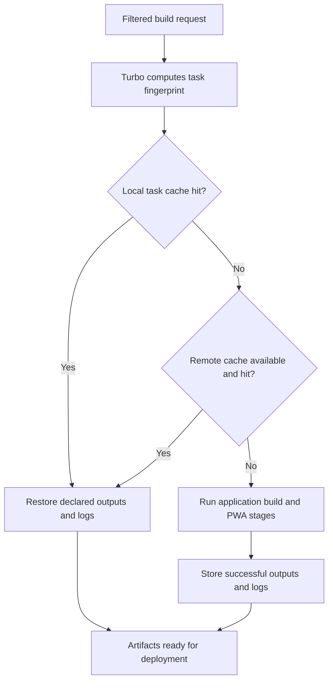

# Deployment and caching

## Turbo task configuration

The root [turbo.json](../turbo.json) applies to all six active workspaces:

| Task         | Scheduling and cache behavior                                                    |
| ------------ | -------------------------------------------------------------------------------- |
| `build`      | Runs dependency workspace builds first through `^build`; caches declared outputs |
| `type-check` | Cacheable; declares `*.tsbuildinfo` as output                                    |
| `test`       | Always executes (`cache: false`)                                                 |
| `dev`        | Persistent and uncached                                                          |

`^build` follows package dependency relationships, not the order of directories
under `apps/`. The apps currently have no shared internal package layer. The root
build command limits concurrency to two; each Vercel build command filters a
single app and does not include that root concurrency option.

Build outputs are relative to each workspace:
- `.next/**`, excluding `.next/cache/**` and `.next/dev/**`.
- `out/**`, including the generated local PWA service worker.
- `public/dalis-sw.js` for the tasks app.

Build inputs extend `$TURBO_DEFAULT$`, preserving Turbo's default file selection
and Git-ignore handling instead of restricting inputs to a few file extensions.
This includes JavaScript service-worker templates, configuration files, and other
asset formats. Explicit `.env*` and `$TURBO_ROOT$/.env*` entries also hash ignored
environment files in the app and repository root, respectively. App-local files
invalidate that app's build; root environment files invalidate every app's build.

Tests (`test/setup.ts` and `**/*.test.ts*`) and generated outputs (`.next/`, `out/`,
`public/dalis-sw.js`, TypeScript build metadata, and `next-env.d.ts`) are excluded
from build inputs. Generated output changes therefore do not invalidate their
own task. See [Turbo input configuration](https://turborepo.dev/docs/reference/configuration#inputs).

## Three different caches

| Cache                              | Scope                                             | Purpose                                              |
| ---------------------------------- | ------------------------------------------------- | ---------------------------------------------------- |
| Next.js / Turbopack compiler cache | App-local compiler work                           | Reuses portions of compilation                       |
| Turbo local task cache             | Repository task results, normally under `.turbo/` | Restores complete declared outputs and logs          |
| Turbo remote cache                 | Team-accessible task artifacts                    | Shares task results between machines and deployments |

Vercel's restored build cache is another platform mechanism. Its log message does
not by itself prove a Turbo remote-cache hit. Turbo's own logs report task cache
hits, misses, and whether remote caching is enabled.



The [Turbo caching documentation](https://turborepo.dev/docs/crafting-your-repository/caching)
explains task fingerprints and output restoration. Remote caching requires team
authorization; it is not enabled merely by committing `turbo.json`.

For local authentication, run `bun run turbo login` and `bun run turbo link`.
Headless environments can supply `TURBO_TEAM` and `TURBO_TOKEN`. The current GitHub
Actions workflow does not wire those variables into its job. Do not place tokens
in versioned files.

## Environment handling and cache limits

The current configuration sets `envMode: "loose"`. Environment variables remain
available to tasks, but availability does not automatically make every value part
of their cache fingerprints. `globalEnv` currently contains negative patterns for
`TURBO_TELEMETRY_DISABLED` and `VERCEL_DEPLOYMENT_ID`; there is no explicit per-app
build-variable list. App-local and root `.env*` files are included in build inputs.

Consequently, do not assume a changed private build variable supplied directly by
the shell or deployment platform, or external database state, always invalidates
an existing artifact. File hashing covers environment-file changes; it does not
replace variable declarations for CI and production. Before
relying on shared build artifacts, declare every relevant input and variable;
use an uncached run when diagnosing an uncertain result. Strict environment mode
and complete app-specific variable declarations were migration goals, but are
not the configuration currently checked in. See
[Turbo environment variables](https://turborepo.dev/docs/crafting-your-repository/using-environment-variables).

## Vercel project configuration

Each app has a separate `vercel.ts` declaring:
- A filtered `turbo run build` with telemetry disabled.
- `bunVersion: "1.4.x"` and a guarded Bun 1.4.4 installation command.
- Region `cdg1` and a route rule denying requests without the expected `ES` country header.

The function region does not control the region printed for Vercel's build machine.
The actual project bindings, domains, environment values, and deployed runtime
must be verified in Vercel; source configuration alone is not deployment evidence.

Set each Vercel project's Root Directory to its `apps/<name>` directory and allow
access to files above it, so the root workspace manifest, lockfile, and tooling
are available. The local template publishes its static `out/` export.

The current home-management installation command is:

```sh
[ "$VERCEL_INSTALL_COMPLETED" = "1" ] || bunx bun@1.4.4 install --frozen-lockfile --filter @damaca/dalis-home-management
```

The condition skips installation only when that variable equals `1`. The command
itself does not set the variable. Observed Vercel logs show installation before
TypeScript config compilation and another install phase afterwards; verify the
variable's behavior in the actual build environment rather than assuming it.

`bunVersion` does not ensure the pre-compilation installer has already switched
versions. Earlier build logs used Bun 1.3.14, which could not read the root
lockfile version 2. The versioned `bunx` invocation selects Bun 1.4.4 for that
installation. This follows Vercel's
[specific Bun version guidance](https://vercel.com/kb/guide/how-to-pin-a-specific-bun-version-for-vercel-builds).

## Deployment diagnostics

| Symptom                                                    | Meaning and next check                                                                         |
| ---------------------------------------------------------- | ---------------------------------------------------------------------------------------------- |
| `Unknown lockfile version` from Bun 1.3.x                  | The installer is older than the lockfile format; inspect the command before config compilation |
| `No locally installed turbo`                               | App-only installation can omit root devDependencies; install the root package as well          |
| Global Turbo reports `Unsupported bun lockfile version: 2` | Confirm the build uses the repository's Turbo 2.11.10 instead of the older global binary       |
| Expected output missing on a cache hit                     | Verify the file is in the task's declared outputs                                              |
| An environment or asset change reuses old output           | Review explicit build inputs and variable hashing                                              |

The current app-only install filter does not explicitly select the root package,
where Turbo is declared. To install root tooling and one app, Bun supports combined
filters, for example:

```sh
bunx bun@1.4.4 install --frozen-lockfile --filter damaca-vercel-apps --filter @damaca/dalis-home-management
```

This is a troubleshooting adjustment, not the command currently in the app configs.
See [Bun workspace filtering](https://bun.sh/docs/pm/filter). Keep build filters
scoped to the app even when installation also includes root tooling.

Useful read-only checks from the repository root:

```sh
bun run turbo --version
bun run turbo ls
bun run turbo run build --filter=@damaca/dalis-home-management --dry=json
```

A meaningful remote-cache verification builds once, then repeats with local cache
reads disabled, for example using `--cache=remote:rw`. Confirm the task logs show a
remote hit and that the expected artifacts, including service workers, are present.
Successful local checks alone do not establish that a Vercel preview, login flow,
or offline application behavior has been validated.
