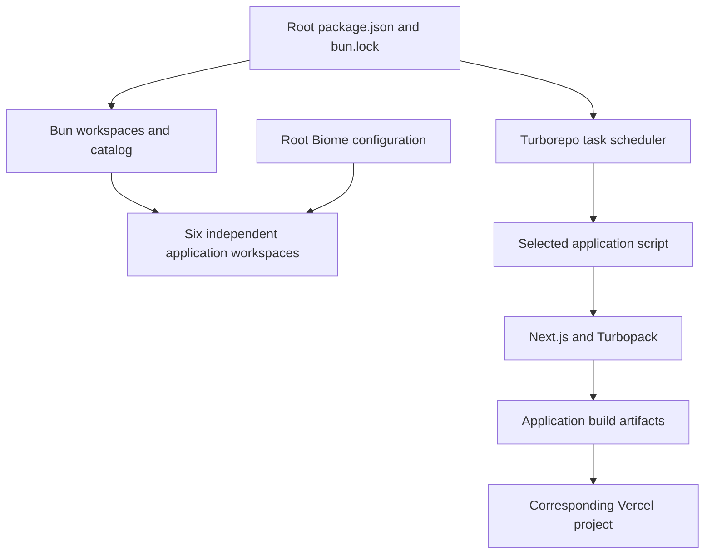

# Monorepo architecture and daily workflow

## Repository boundaries

`damaca-vercel-apps` contains six independent applications. They share dependency
versions and tooling, while retaining their own source code, configuration, tests,
environment variables, and Vercel projects. There is currently no shared
`packages/` workspace or common application build artifact.

```text
damaca-vercel-apps/
├── apps/
│   ├── billing-poc/
│   ├── dalis-home-management/
│   ├── dalis-tasks-events/
│   ├── pocha-score/
│   ├── card-wars/
│   ├── damaca-hub/
├── docs/
├── .github/workflows/ci.yml
├── biome.json
├── bun.lock
├── package.json
└── turbo.json
```

| Application directory        | Workspace name                  | Development port | Build result                                     |
| ---------------------------- | ------------------------------- | ---------------- | ------------------------------------------------ |
| `apps/billing-poc`           | `@damaca/billing-poc`           | 3000             | Next.js application                              |
| `apps/dalis-home-management` | `@damaca/dalis-home-management` | 3001             | Next.js application                              |
| `apps/dalis-tasks-events`    | `@damaca/dalis-tasks-events`    | 3002             | Next.js application and `public/dalis-sw.js`     |
| `apps/pocha-score`           | `@damaca/pocha-score`           | 3003             | Static Next.js PWA with IndexedDB                |
| `apps/card-wars`             | `@damaca/card-wars`             | 3004             | Static Next.js PWA with IndexedDB                |
| `apps/damaca-hub`            | `@damaca/damaca-hub`            | 3005             | Next.js application with Google auth and MongoDB |



## Dependency management

The root [package.json](../package.json) is private and declares
`workspaces.packages: ["apps/*"]`. Its `workspaces.catalog` contains exact shared
dependency versions; applications reference them with `"catalog:"`.

```json
{
  "dependencies": {
    "next": "catalog:",
    "react": "catalog:"
  }
}
```

Applications declare only the dependencies they use. A catalog centralizes direct
versions without forcing every transitive dependency to have one version. See
[Bun catalogs](https://bun.sh/docs/pm/catalogs) for the protocol.

The current toolchain includes Bun 1.4.4, Next.js 16.4.3, React 19.3.1,
Turborepo 2.11.10, and Biome 2.6.2. The root `packageManager` pins Bun; GitHub Actions
also installs Bun 1.4.4 and Node.js 24. Package manifests currently do not declare
an `engines.node` constraint. Turbo is pinned directly in root `devDependencies`;
Biome uses the catalog. SheetJS uses its official tarball URL in the catalog.

To update a shared dependency:
1. Change its catalog entry in root `package.json`.
2. Keep consumer declarations on `catalog:`; add a consumer only where needed.
3. Run `bun install` at the root and review the resulting `bun.lock` diff.
4. Validate affected workspaces before publishing the manifest and lockfile together.

`bun.lock` is tracked and is the only installation lockfile. Its format version is
2, so use Bun 1.4.4 rather than the older Bun supplied by some build images.
Do not create app-local lockfiles.

## Running the repository

Run these commands from the repository root:

```sh
bun install --frozen-lockfile
bun run dev
```

| Root command         | Current behavior                                                                 |
| -------------------- | -------------------------------------------------------------------------------- |
| `bun run dev`        | Starts all six app dev servers through Turbo in parallel                         |
| `bun run build`      | Runs builds through Turbo with concurrency limited to two and telemetry disabled |
| `bun run type-check` | Runs each workspace's `tsc --noEmit`                                             |
| `bun run test`       | Runs workspace test scripts; Turbo does not cache these tests                    |
| `bun run lint`       | Runs Biome checks across supported repository files, respecting Git ignores      |
| `bun run lint:fix`   | Applies Biome fixes across that same scope                                       |
| `bun run format`     | Applies Biome formatting across that same scope                                  |

Filter Turbo tasks by the full workspace name:

```sh
bun run dev --filter=@damaca/dalis-home-management
bun run build --filter=@damaca/billing-poc
bun run test --filter=@damaca/dalis-tasks-events
bun run type-check --filter=@damaca/dalis-tasks-events
```

Application-specific commands remain in their own manifests. Run one with Bun's
`--cwd` option, for example:

```sh
bun run generate:app
```

The generator creates either an authenticated MongoDB app or a static local PWA
under `apps/<identifier>`; use its printed commands to install dependencies and
run the generated app. Database indexing, migration, sample-data, and service integration scripts remain
explicit app commands and are not automatically run by the root test task.

## Environment and application rules

Keep local environment files in the corresponding app directory. Examples exist
in `billing-poc/.env.local.example` and in `.env.example` in the home-management
and tasks-events apps. Generated MongoDB apps include their own `.env.example`.
Configure deployed values separately in
each Vercel project. Never commit real `.env.local` files or credentials.

Follow root [AGENTS.md](../AGENTS.md) and any instructions inside the app being
edited. Shared tooling does not remove application-specific data and architecture
boundaries. Work happens on `int`; `main` remains human-managed.

## Biome and CI

The root [biome.json](../biome.json) supplies a single configuration, including
React, Next.js, and test domains, import organization, and Tailwind CSS parsing.
Local lint scripts currently check the repository, not only staged files. For an
explicit staged check, use `bun run lint --staged`.

The [CI workflow](../.github/workflows/ci.yml) runs on pushes and pull requests to
`int` and `main`. It installs frozen dependencies, runs incremental Biome checks,
then types and tests. The Biome base is the PR merge-base, the previous push SHA,
or the initial commit for a first push. The current workflow does **not** run
application builds or configure Turbo remote-cache credentials. Builds run through
the Vercel projects or a local `bun run build`.
