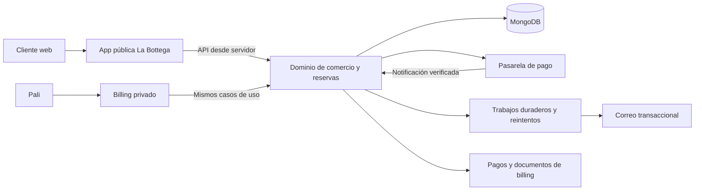

# Arquitectura e interoperabilidad: alternativas

Todas las decisiones siguientes son **propuestas**, pendientes de las respuestas de [08](08-decisiones-pendientes.md). Restricciones actuales: [workflow raíz](../../../plan/workflow.md), apps independientes y secretos por entorno. Se comparan tres cosas distintas: unidad de despliegue, acceso a datos y propiedad de las reglas de negocio.

## Comparación de opciones

| Opción | Ventajas | Costes y riesgos | Valoración para La Bottega |
| --- | --- | --- | --- |
| A. Nueva web pública y API de negocio alojada inicialmente en billing | Despliegues y diseño separados; administración única; dominio compartido mediante contratos. | Latencia y fallos de red; hay que versionar contrato y autenticar máquinas; backend depende del runtime de billing. | **Recomendada**, con una API acotada y un único propietario de cada escritura. |
| B. Nueva web con lectura/escritura directa sobre las colecciones actuales de billing | Menos saltos HTTP; desarrollo inicial aparente más corto. | Acoplamiento a esquema, credenciales amplias y reglas duplicadas; saltarse validaciones es fácil; cambios coordinados. | Descartada como diseño objetivo. Estar en el servidor no elimina estos riesgos. |
| C. Una sola app billing con rutas públicas y privadas | Casos de uso locales, menos configuración y sin llamada HTTP entre frontends. | Releases y fallos compartidos; refactor de proxy/layout/auth; mayor riesgo de filtrar datos/cachés; mezcla de necesidades editoriales y administrativas. | Viable si prima minimizar operación y se acepta el acoplamiento. No es mi primera elección. |
| D. Nueva web sobre WooCommerce sin interfaz WordPress pública | Se puede modernizar diseño conservando pedidos, checkout o API existentes. | WordPress, plugins y hosting siguen siendo necesarios; dos sistemas continúan conviviendo. | Buena transición o alternativa si el coste de reemplazar comercio no compensa. No cumple por sí sola prescindir de WordPress. |
| E. Web + plataforma de comercio/reservas gestionada | Menor mantenimiento del motor comercial, según cobertura del proveedor. | Cuotas, personalización de clases/bonos y conectores; billing sigue necesitando integración fiable. | Evaluar solo si no se quiere mantener un motor propio; no hay proveedor seleccionado ni análisis contractual aquí. |

**A y C pueden ofrecer exactamente los mismos datos únicos.** La independencia de apps no obliga a duplicar catálogo; una sola app tampoco garantiza que deje de duplicarse. La condición decisiva es un caso de uso canónico que utilicen todos los canales.

## Topología recomendada

Al principio, `Commerce` y la adaptación a `Ledger` viven en el backend de billing, con módulos separados. El esquema representa responsabilidades lógicas, no seis despliegues nuevos. Los trabajos pueden usar una bandeja persistente y un ejecutor programado; no hace falta introducir una plataforma distribuida completa. La solución de ejecución se seleccionará en el diseño posterior.

La app pública propuesta podría residir en `apps/la-bottega`; el nombre es orientativo. Antes de implementarla debe tener los tres documentos de planificación exigidos por el monorepo. Vercel debe apuntar a esa raíz, con secretos propios, configuración de entorno y preproducción sin cobros reales. No se crea en esta entrega.

## Qué se comparte y qué se separa

| Elemento | Propuesta |
| --- | --- |
| Presentación | Sitio público con identidad de La Bottega; billing conserva su UI de gestión. |
| Código de dominio | Casos de uso únicos; extraer un paquete interno cuando haya un consumidor real adicional. No compartir componentes privados por conveniencia. |
| Base de datos | Misma infraestructura Mongo si su capacidad/aislamiento lo permite. Colecciones comerciales nuevas bajo un propietario; credenciales del backend con privilegios mínimos. |
| Acceso público a datos | Solo proyecciones de publicación. No devolver un documento Mongo completo para ocultar después campos en React. |
| Escrituras | Backend del dominio comercial; interfaz administrativa y web invocan los mismos invariantes. |
| Identidad | Administración actual separada de comprador/invitado. No compartir cookies administrativas con clientes. |
| Facturación | Billing conserva documentos y numeración; el comercio envía un hecho económico con identificador único. |
| Contenido editorial | Textos/fotos publicables gestionados desde billing si Pali necesita autonomía. Git/Markdown solo si acepta depender del desarrollador. |
| Recursos | Fotos públicas en almacenamiento de objetos; PDFs e información privada en acceso autenticado o enlaces temporales. |

Compartir un clúster no obliga a compartir una base lógica; compartir una base no obliga a permitir a dos apps escribir cada colección. Para la primera fase, un dominio comercial con único escritor reduce el problema. Una proyección pública de solo lectura sería una evolución posible si se necesita resiliencia, no una segunda fuente editable.

## Contrato de integración que haría falta definir

No existe todavía una API comercial aprobada. En el diseño posterior separaría estas capacidades:

- Consultas publicadas de experiencias, convocatorias y disponibilidad resumida, sin asistentes, emails ni facturas.
- Cotización de una compra a partir de IDs/cantidades; precios, impuestos y descuentos calculados por servidor.
- Reserva temporal de plazas/stock y creación de un pedido mediante clave de idempotencia. Cotizar no implica reservar.
- Inicio de un intento de pago sobre ese pedido; nunca aceptar un total afirmado por el navegador.
- Consulta limitada de estado por credencial de compra o sesión de cliente; conocer un ID no da acceso.
- Notificación de pasarela con autenticación de su protocolo, no sesión administrativa.
- Operaciones privadas de publicación, venta física, cambio/cancelación y devoluciones, con autorización y auditoría.

Las llamadas servidor a servidor deben tener credencial revocable, permisos limitados y separación de entornos. CORS no autentica un servidor. La credencial de la app pública no puede permitir listar todos los clientes o facturas. Aplicar control de abuso tanto a la entrada pública como al backend: una credencial de máquina no identifica al comprador ni evita que alguien abuse del frontend legítimo.

El proxy actual de billing exige excepciones **exactas** para las nuevas rutas de integración y pasarela. Su propia guardia deberá validar cada petición. No abrir `/api/*` ni retirar `requireAuth` de las APIs privadas existentes. Los secretos jamás se envían al navegador. Verificar también la protección de despliegue de Vercel y su compatibilidad con llamadas/notificaciones: la autenticación de negocio y la del alojamiento son capas distintas. No desproteger previews para resolverlo.

## Flujo que evita duplicar una venta

1. Pali crea una experiencia y su convocatoria en billing; publica título, descripción, fotos, fecha y precio. No vuelve a crear un producto variable en otro sistema.
2. El cliente selecciona convocatoria y plazas. El servidor vuelve a calcular la compra y solicita un hold con vencimiento.
3. El backend guarda pedido e intento antes de enviar al TPV; persiste las referencias necesarias para resolver respuestas perdidas.
4. La notificación verificada de la pasarela se procesa idempotentemente. La vuelta del navegador solo muestra un estado, no acredita el cobro.
5. Se confirman reserva y hecho económico. Si la actualización contable no puede completarse en la misma transacción local, queda una tarea persistente con reintento y estado visible en billing.
6. Una referencia única impide crear dos ingresos para el mismo cobro. Un fallo de correo no anula el pago ni obliga a repetir la compra.
7. La venta manual usa el mismo servicio de aforo/stock. El origen permite analizar canales, pero no crea inventarios distintos.

## Reembolsos, bonos y conciliación

Una devolución debe registrar cantidad/plazas afectadas, importe, motivo, operación de pasarela y documento contable que corresponda. Cambiar el estado de una reserva no devuelve dinero. Devolver dinero tampoco debe dejar ocupada una plaza indefinidamente. El proceso admite estados intermedios y reparación; no se promete atomicidad entre base y banco.

Los bonos emitidos en tienda y online deben compartir emisor, validez y estado de uso. La compra de bono, su utilización como medio de aplicación a otra compra y el posible pago de diferencia son hechos distintos. Se define el tratamiento contable con gestoría para evitar contar dos veces el mismo dinero.

Una pantalla de conciliación debe hacer visibles cobros sin reserva confirmada, reservas sin cobro, tareas fallidas, devoluciones pendientes y bonos pagados sin entrega. Es más valiosa que ocultar los fallos con reintentos indefinidos.

## Disponibilidad, caché y despliegues

Las páginas de captación pueden servirse desde una versión pública almacenada en caché y tolerar una indisponibilidad temporal del backend. La disponibilidad mostrada es orientativa hasta que el backend admite el hold. En ningún caso una página cacheada debe garantizar la última plaza.

Nunca cachear respuestas privadas junto al catálogo. La publicación de una convocatoria invalida la caché pública; la confirmación de reserva usa datos actuales y falla de forma explícita si el backend no está disponible. Las notificaciones y reintentos viven en el backend estable, no en una URL efímera de preview.

Tener proyectos separados no elimina recursos compartidos: pueden compartir equipo Vercel, base, proveedor de correo y límites de gasto. Un cambio del backend debe ser compatible con la versión pública anterior durante el despliegue; evitar que una migración de esquema exija dos publicaciones simultáneas.

## Cuándo elegiría una sola app

Si el coste operativo de dos proyectos/API es mayor que el beneficio de publicaciones independientes, aceptaría una app con área pública y privada. Exigiría layouts y proveedores separados, políticas de caché explícitas, permisos de servidor por operación y pruebas de acceso anónimo a todas las rutas privadas. Los grupos de rutas de Next.js ordenan archivos; no son un control de acceso.

No refactorizaría todo billing para conseguirlo. Extraería primero el dominio y sus pruebas de invariantes. Más adelante se podría separar la fachada pública conservando esos casos de uso. En ambas opciones, el trabajo difícil sigue siendo la corrección del comercio, no el número de apps.
