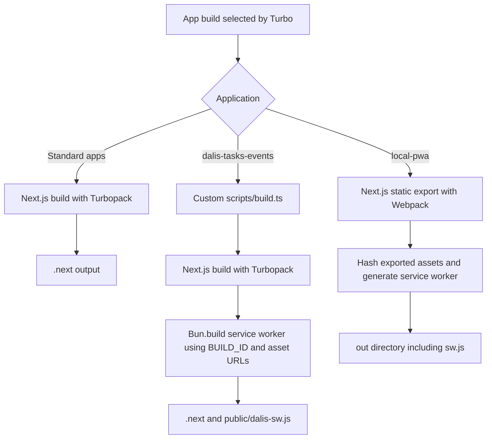

# Turbopack in this repository

## Turbopack and Turborepo

Turbopack is the Rust-based incremental bundler integrated into Next.js. It tracks
module dependencies and reuses compilation work; development compiles routes as
they are requested and supports Fast Refresh. Next.js 16 uses it by default for
`next dev` and `next build`. Turbopack transforms TypeScript, but the separate
`type-check` task checks its types. See the
[Next.js Turbopack reference](https://nextjs.org/docs/app/api-reference/turbopack).

Turborepo operates one level above this: it decides which workspace scripts run,
in which order, and whether their complete outputs can be restored from cache.
On a Turbo cache hit, Next.js does not run for that task, so Turbopack does not need
to compile anything. Bun supplies the package manager, runtime, and PWA bundling
scripts; it is not the Next.js bundler.

## How it is enabled here

The catalog pins Next.js 16.4.3. All three app dev scripts invoke
`bun run --bun next dev` with distinct ports. The normal build scripts invoke
`bun run --bun next build`; `dalis-tasks-events` wraps Next.js in a custom build
script. No current dev/build script passes `--webpack`.

There is no standalone Turbopack installation or root Turbopack configuration.
Each application has its own `next.config.ts`, and none currently declares a
`turbopack` block:

| Configuration                                                                  | Repository-specific behavior                                         |
| ------------------------------------------------------------------------------ | -------------------------------------------------------------------- |
| [billing-poc](../apps/billing-poc/next.config.ts)                              | Development origins, Google-hosted image patterns, React strict mode |
| [dalis-home-management](../apps/dalis-home-management/next.config.ts)          | Default Next.js configuration                                        |
| [dalis-tasks-events](../apps/dalis-tasks-events/next.config.ts)                | Service-worker content type, scope, and no-cache headers             |
| [local-pwa base](../turbo/generators/templates/local-pwa/next.config.ts)       | Static export and trailing slashes                                   |
| [mongo-google base](../turbo/generators/templates/mongo-google/next.config.ts) | Default Next.js configuration                                        |

Next.js infers the filesystem root from lockfiles. The repository relies on the
single root `bun.lock`; it does not explicitly set `turbopack.root`. Nested or
unrelated lockfiles can change that inference. If root detection becomes ambiguous,
configure `turbopack.root` deliberately in the affected app rather than assuming
Turbo's workspace selection also controls module resolution. See the
[Turbopack configuration reference](https://nextjs.org/docs/app/api-reference/config/next-config-js/turbopack).

## Build paths and service workers



The tasks app's [build script](../apps/dalis-tasks-events/scripts/build.ts) first
spawns `bunx next build`. After a successful Next.js build, it collects static
assets, reads `.next/BUILD_ID`, and uses `Bun.build` to compile its service worker
into `public/dalis-sw.js`. The worker generation is a separate stage after
Turbopack and belongs to the same Turbo build task.

The `local-pwa` generator base exports static files to `out/`. Its
[worker generator](../turbo/generators/templates/local-pwa/scripts/build-service-worker.ts)
hashes the exported content and the worker template, checks required routes, and
writes `out/sw.js`. Its `start` script serves the export through Bun instead of
`next start`.

Turbo declares both worker outputs in its cacheable artifacts. Restoring a full
build should restore the corresponding worker as well; caching only `.next/`
would omit the generated worker in the tasks app.

## Development and troubleshooting

Use a filtered root command to keep feedback focused:

```sh
bun run dev --filter=@damaca/dalis-home-management
bun run type-check --filter=@damaca/dalis-home-management
bun run build --filter=@damaca/dalis-home-management
```

When diagnosing a build, distinguish a Turbo cache hit from an actual compiler
run. To force compilation through the current scripts:

```sh
bun run build --filter=@damaca/dalis-home-management --force
```

Check the installed Next.js version, native platform support, root detection, and
the app's own configuration before changing bundler settings. A Webpack plugin or
`webpack()` configuration is not automatically a Turbopack integration. Keep
Turbopack enabled when resolving compatibility failures; changing the bundler
changes the build being validated.

For PWA validation, use a production build and a browser, then verify worker
registration, controlled navigation, and offline reload. A successful compiler
run or restored cache artifact alone does not prove offline behavior.
